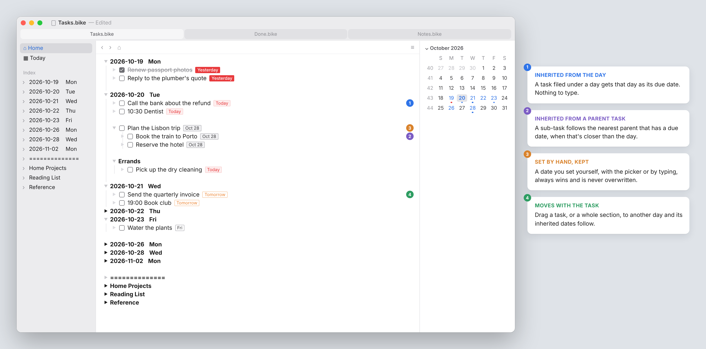
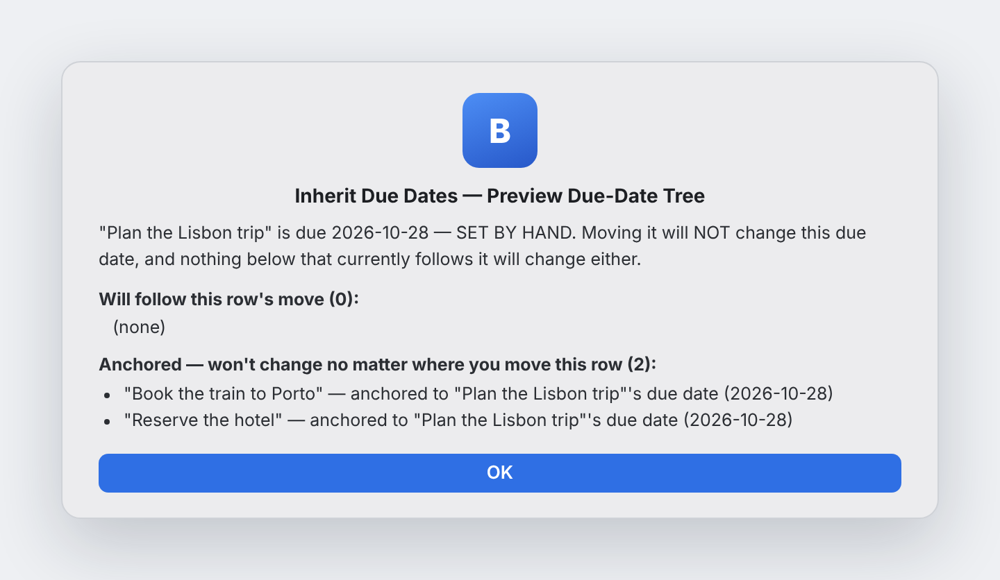

# Inherit Due Dates for Bike

Tasks in [Bike 2](https://www.hogbaysoftware.com/bike/) take their due date from the day they're filed under. Put a task under a day and it's due that day. Move it to another day and the date moves with it. Set a date yourself and the extension leaves it alone.

[](images/screenshot.png)

Inherit Due Dates is for people who plan by day. If your outline already has a row for each day, you shouldn't have to type that same date again on every task under it.

## Install

1. Download `inherit-due-dates.bkext.zip` from the [latest release](../../releases/latest) and unzip it.
2. Quit Bike, then copy `inherit-due-dates.bkext` into Bike's Extensions folder, replacing any older copy:
   `~/Library/Containers/com.hogbaysoftware.Bike/Data/Library/Application Support/Bike/Extensions/`
3. Open Bike and check that Inherit Due Dates is listed and turned on in Extensions Explorer.
4. Run **Inherit Due Dates: Sync Whole Document** from the Command Palette to date the tasks already in your outline.

Requires Bike 2 (macOS) with extension API 0.72 or later.

**Updating:** Bike can keep running an extension's old code after its files change. When you update, replace the folder and relaunch Bike.

## What it does

**Day rows give their date to tasks.** Every task under a day row gets that day in Bike's `@due` attribute. Tasks nested deeper — inside a project heading, say — inherit it too.

**A parent task can give its date to sub-tasks.** If a sub-task sits under a task (or heading) that has a due date, and that parent is closer than the day row, the sub-task follows the parent instead. Change the parent's date and its sub-tasks follow.

**Your own dates always win.** A date set with Bike's date picker, typed by hand, or written by another extension is yours, and the extension never overwrites it. That holds even for a task that was already inheriting a date.

Clearing a date by hand also sticks at first. But an empty task under a dated row is free to inherit again, so the next edit that touches it (a move, a parent's date changing) will give it the inherited date back. To keep a task undated, move it out from under anything with a date.

**Moves carry dates along.** Drag a task, or a whole section, to a different day and every inherited date inside it updates. Tasks with their own dates stay put.

**Stale dates are cleaned up.** If a task moves out from under anything with a date, or its source loses its date, the inherited date is removed rather than left behind. A date you set yourself is never removed this way.

## Commands

All three are in the Command Palette.

- **Inherit Due Dates: Sync Whole Document** fills in or refreshes every inherited date in the document. Run it once after installing, since the extension otherwise only updates rows as you edit them. It's also the catch-all if anything ever looks out of sync.
- **Inherit Due Dates: Preview Due-Date Tree** shows what will happen before you move a parent task or heading. A parent with an inherited date carries its sub-tasks with it when moved. A parent with a hand-set date carries nothing, not even itself. The two look the same in the outline, so this command tells you which one you have and lists which tasks will follow the move and which are anchored.
- **Inherit Due Dates: Debug Selected Row** reports what the extension sees for the selected row: its type and attributes, its hidden id, the day row it's under, and the date it would inherit.

[](images/preview.png)

## How it finds day rows

A row counts as a day in one of two ways, checked in this order:

1. **It was made by Bike's Calendar panel.** Double-clicking a date in the Calendar creates a row with a hidden id like `2026/10/21`. The extension reads that id, so the row's title can be in any format or language.
2. **Its title starts with a date.** A heading whose text begins `YYYY-MM-DD` (for example `2026-10-21 Wed`) also counts, for outlines whose day headings were typed by hand.

The Calendar panel is the recommended way to make day rows. The Calendar itself only recognizes rows by id, so a hand-typed heading works with this extension but not with the Calendar: double-clicking that date there makes a second row. To fix that, give the heading an id in the `YYYY/MM/DD` form. The extension doesn't do this for you.

Headings without a date and without a `@due` of their own, like "Errands" or "Reference", are passed straight through. Tasks inside them inherit from whatever day they sit under.

## How it writes to your outline

- Dates go into Bike's standard `@due` attribute as `YYYY-MM-DD`, so the Calendar, saved queries and other extensions see them as ordinary due dates.
- To tell its own dates from yours, the extension adds one hidden attribute, `inherit-due-dates-auto`, to tasks it dated. It doesn't appear as a badge, in the Attributes settings or in a row's log. Uninstalling leaves the dates and the marker in place.
- It never reorders, creates or deletes rows.

## Building from source

Requires Node.js 20.11 or later.

```
npm install
npm run build          # builds to out/extensions/inherit-due-dates.bkext
npm run install-ext    # builds and installs into Bike
npm run watch          # rebuilds on every save
```

If `install-ext` doesn't land the extension, copy `out/extensions/inherit-due-dates.bkext` into `~/Library/Containers/com.hogbaysoftware.Bike/Data/Library/Application Support/Bike/Extensions/` yourself. After a rebuild, toggle the extension off and on in Extensions Explorer, or relaunch Bike.

- `src/inherit-due-dates.bkext/manifest.json` describes the extension.
- `src/inherit-due-dates.bkext/app/main.ts` holds everything: the reconcile rule that keeps `@due` in sync, the day-row detection, and the three commands. It's commented throughout.

Two settings live at the top of `main.ts`. `DUE_ATTRIBUTE` is the attribute dates are written to. `HEADING_DATE_PATTERN` is how a date is found in a hand-typed heading, if yours aren't titled `YYYY-MM-DD`.

The extension is built on Bike's `bike.reconcile()` API. A rule runs as each edit closes, inside the same transaction, so inherited dates update in the same undo step as the change that caused them.

## Credits

By Art Currim. Built with Claude: I designed and tested it; Claude wrote the code.

Thanks to Jesse Grosjean for suggesting matching day rows by their Calendar id, and to [biznachio](https://github.com/biznachio), whose [HUD for Bike](https://github.com/biznachio/bike-hud) repo inspired this page.

## License

MIT. See [LICENSE](LICENSE).
